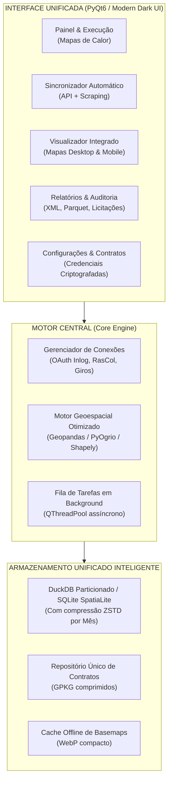

# DOCUMENTO DE ARQUITETURA E ESPECIFICAÇÃO TÉCNICA
## Consolidação e Unificação dos Sistemas de Operação e Mapas de Calor — Locar (FS - DIE)

---

## 1. INTRODUÇÃO E OBJETIVO

O presente documento apresenta a **análise técnica aprofundada, inventário de engenharia reversa e especificação de software** da infraestrutura de ferramentas de geoprocessamento e automação da diretoria/operação **FS - DIE (Locar)**.

### Objetivo Estratégico
Substituir o ecossistema fragmentado atual (composto por **6 executáveis independentes**, múltiplos processos de scraping, duplicidade de arquivos e consumo desordenado de mais de **50 GB de armazenamento**) por uma **Solução Única e Integrada: Locar Operations Suite (Locar GIS)**.

O novo aplicativo será uma plataforma profissional, modular e autônoma, centrada no **motor de mapas de calor e monitoramento de execução de coleta**, englobando coleta de dados (API e scraping), processamento espacial e relatórios em um único executável de alta performance.

---

## 2. INVENTÁRIO COMPLETO E ENGENHARIA REVERSA DA PASTA `FS - DIE`

### 2.1 Estrutura de Diretórios e Papel de Cada Pasta

```
C:\Users\NELMAC\CarlosDorth\FS - DIE\
│
├── dependencias\                  # Base operacional central
│   ├── .env                      # Arquivo central unificado de configurações e credenciais
│   ├── CONTRATOS\                # Shapefiles/GPKG oficiais de setores e rotas por praça
│   │   ├── CABO - DIURNO\        # Pastas por contrato e turno (setores/ e rotas/)
│   │   ├── CANELA - DIURNO\
│   │   └── ... (11 praças operacionais)
│   ├── shapes\                   # Zips diários baixados pelo InlogAutomation ("Shapes - dd.mm.aaaa.zip")
│   ├── outputs\                  # Saídas brutas de processos e bancos locais
│   │   ├── gps.duckdb            # Banco colunar DuckDB com histórico de GPS (23.5 GB)
│   │   ├── raw\vehicles\         # Parquets com cadastro de frota do InlogAPI
│   │   └── Veículos - Inlog\     # veiculos_contratos.xlsx gerado pelo InlogAutomation
│   └── logos_prefeituras\        # Imagens para templates de licitação
│
├── CACHE_MAPA_BASE\               # Tiles em cache do OpenStreetMap/Esri para mapas offline
├── HEATMAPS\                      # Saída final dos mapas interativos (.html desktop e mobile)
├── HISTORICO\                     # Histórico consolidado em formato parquet (.parquet)
├── RELATORIOS_HEATMAPS_XML\       # Relatórios de auditoria e conformidade em XML
├── INDICADORES\                   # Dados exportados para dashboards Power BI
├── Utilitarios\                   # Scripts auxiliares e builds intermediários
│
├── HeatmapsGenerator.exe          # [APP 1] Motor de Mapas de Calor e Aderência
├── InlogAPI.exe                   # [APP 2] Coletor REST API Inlog (GPS + Frota)
├── InlogAutomation.exe            # [APP 3] RPA / Web Scraping no Portal Inlog
├── RasColAutomation.exe           # [APP 4] RPA / Web Scraping no Portal RasCol
├── GirosAutomation.exe            # [APP 5] RPA no Portal Giros (Ponto e Jornada)
└── Gerador de Template.exe        # [APP 6] Gerador de Cadernos e PDFs de Licitação
```

---

### 2.2 Análise Individual dos 6 Aplicativos

#### 2.2.1 `HeatmapsGenerator.exe` (Módulo Principal — Mapas de Calor)
* **Objetivo:** Processar o rastro GPS dos caminhões de lixo contra as rotas e setores planejados, gerando o mapa de calor da coleta, percentual de cumprimento e relatórios técnicos.
* **Entradas de Dados:**
  1. `dependencias/outputs/gps.duckdb`: Tabela `gps_history` (pontos brutos) e `vehicle_contract_timeline` (vinculação placa-contrato).
  2. `dependencias/shapes/Shapes - dd.mm.aaaa.zip`: Fallback e complemento de shapefiles (essencial para praças que não estão na API Inlog, como Jaboatão).
  3. `dependencias/CONTRATOS/{CONTRATO} - {TURNO}/`: Arquivos geoespaciais `.gpkg` e `.shp` contendo as camadas `setores` (polígonos com agenda nos nomes) e `rotas` (linhas viárias).
  4. `dependencias/outputs/raw/vehicles/*.parquet` e `veiculos_contratos.xlsx`: Cadastro de equipamentos para filtrar apenas caminhões compactadores (`COMPACTADOR`).
* **Regras de Negócio e Algoritmos Spaciais:**
  - **Janela Operacional Diária (`janela.py`):** O dia de coleta não fecha à meia-noite. Aplica janela dinâmica (padrão 05:00 D até 05:00 D+1; contratos como Cuiabá iniciam 04:00, Olinda estende até 07:00). Pontos da madrugada são vinculados ao dia operacional correto.
  - **Deduplicação Inteligente:** Remove sobreposições entre registros do DuckDB e arquivos shapefiles zipados.
  - **Projeção Cartográfica:** Converte dados para projeção métrica planar (`EPSG:31985` - UTM Sirgas 2000) para cálculos de distância exatos, e depois para `EPSG:4326` (WGS84) para renderização web.
  - **Buffers de Cobertura:** Cria faixas de tolerância de 8 metros (trecho central) e 15 metros (esquinas e manobras) sobre as vias planejadas.
  - **Classificação de Status por Segmento:**
    - Verde: Coletado conforme rota planejada.
    - Amarelo: Possível falha de GPS / manobra.
    - Vermelho: Não coletado (inadimplência de serviço).
    - Azul/Ciano: Coleta manual ou tipo diferenciado (seletiva/entulho).
  - **Pontos Viciados e Paradas Críticas (`stops_stats.py` / `pontos_viciados.py`):** Detecção de paradas prolongadas (dwell time > 120s ou paradas de esquina > 15s a menos de 5 km/h).
* **Saídas:**
  - Mapas interativos Desktop e Mobile (`HEATMAPS/{Contrato}_{Data}.html`) renderizados via Leaflet/Plotly com basemaps offline.
  - Métricas históricas em `.parquet` (`HISTORICO/`).
  - Arquivos de auditoria técnica XML (`RELATORIOS_HEATMAPS_XML/`).

#### 2.2.2 `InlogAPI.exe` (Coletor REST API)
* **Objetivo:** Estabelecer comunicação direta com os servidores REST da Inlog para capturar telemetria em lote sem depender de navegador.
* **Autenticação:**
  - OAuth2 via Client Credentials Grant (`client_id`, `client_secret`, `server_id` no `.env`).
  - Token URL: `https://locar.inlog.com.br/autenticacao-services/connect/token`.
  - Base API URL: `https://locar.inlog.com.br/IntegrationColeta`.
* **Fluxo de Trabalho:**
  1. `Buscar Veículos`: Consulta lista de equipamentos ativos e salva snapshots em `.parquet`.
  2. `Timeline de Garagens`: Registra entrada/saída de veículos por praça na tabela `vehicle_contract_timeline`.
  3. `Buscar Histórico GPS`: Baixa latitude, longitude, velocidade, data/hora e odômetro, inserindo diretamente em blocos massivos na tabela `gps_history` do `gps.duckdb`.

#### 2.2.3 `InlogAutomation.exe` (RPA Web Inlog)
* **Objetivo:** Acessar o sistema web legador da Inlog via automação de navegador (Selenium / Playwright).
* **Credenciais:** Usuário `die` / Senha `inlog2025`.
* **Papel no Sistema:** Baixar os pacotes diários de shapefiles (`Shapes - dd.mm.aaaa.zip`) que o portal Inlog gera, exportar planilhas de frota (`veiculos_contratos.xlsx`) e alimentar contratos onde a API REST apresenta inconsistências.

#### 2.2.4 `RasColAutomation.exe` (RPA Web RasCol)
* **Objetivo:** Automação de extração de dados no sistema RasCol (`https://id.rassystem.com.br/cas/login`).
* **Credenciais:** Usuário `jorge.edson` / Filial `JABOATAO`.
* **Papel no Sistema:** Jaboatão dos Guararapes opera com sistema de rastreamento RasCol (e não Inlog). Este app extrai o shapefile de rastreio de Jaboatão e salva na pasta `shapes/` para permitir que o `HeatmapsGenerator` processe o mapa da cidade.

#### 2.2.5 `GirosAutomation.exe` (RPA Web Giros)
* **Objetivo:** Automação no portal de controle de ponto e jornadas Giros (`https://locar.giros.com.br`).
* **Credenciais:** Usuário `jorgeedson` / Senha `Jorge096*`.
* **Papel no Sistema:** Extração de jornada e presença de equipes (motoristas e garis) para cruzamento de horas trabalhadas versus trechos percorridos.

#### 2.2.6 `Gerador de Template.exe` (Licitatório)
* **Objetivo:** Diagramação automatizada de memoriais descritivos, mapas de varrição e cadernos técnicos para licitações públicas municipais.
* **Recursos:** Conecta na base de setores, insere os logos prefeiturais específicos (`dependencias/logos_prefeituras/`) e aplica o rodapé legal padronizado das 15 praças da empresa com CNPJ e dados cadastrais.

---

## 3. DIAGNÓSTICO DO MODELO ATUAL: GARGALOS E CAUSAS DO PESO EXCESSIVO (50 GB)

| Gargalo Identificado | Causa Raiz | Impacto |
|---|---|---|
| **6 Python Runtimes Duplicados** | Cada `.exe` foi gerado via PyInstaller com seu próprio bundle de GDAL, NumPy, Pandas, Qt/Tkinter. | ~6 GB desperdiçados apenas em bibliotecas duplicadas. |
| **Banco DuckDB Não Particionado** | O arquivo `gps.duckdb` cresce continuamente em arquivo único monolítico (23.5 GB). DuckDB não faz `VACUUM` automático frequente em updates pesados. | Alto risco de corrupção e lentidão ao abrir o arquivo. |
| **Duplicação DuckDB + Shapefiles** | Os mesmos pontos GPS existem dentro do banco DuckDB E dentro de dezenas de arquivos `Shapes - *.zip`. | Mais de 20 GB de dados espaciais idênticos duplicados. |
| **Interdependência Frágil** | Um aplicativo grava num caminho relativo; se o usuário move de pasta ou executa de outro diretório, nada funciona. | Falhas silenciosas ("Nenhum ponto encontrado"). |
| **Processo Operacional Fragmentado** | O operador precisa: abrir App 2 -> esperar baixar -> fechar App 2 -> abrir App 3 -> baixar zips -> abrir App 1 -> gerar mapa. | Desperdício de tempo e alta incidência de erro operacional. |

---

## 4. ARQUITETURA PROPOSTA: O APLICATIVO UNIFICADO (LOCAR OPERATIONS SUITE)



### 4.1 Principais Ganhos da Solução Unificada

1. **Executável Único e Profissional:** Um único `.exe` de ~180 MB instalado no sistema, com interface desktop limpa, moderna (Dark Theme) e responsiva.
2. **Redução de Armazenamento de 50 GB para < 10 GB:**
   - Eliminação dos shapefiles zipados redundantes: o dado entra diretamente no banco de dados otimizado.
   - Particionamento do banco de telemetria por mês/ano com compressão colunar nativa **ZSTD**.
   - Cache de mapas de fundo em formato **WebP**, economizando até 70% de espaço em relação aos tiles PNG.
3. **Fluxo "1-Click Workflow":** O operador escolhe as datas e clica em **"Atualizar e Gerar"**. O aplicativo:
   - Verifica se faltam dados daquele dia;
   - Se faltar, ativa o worker em background da API Inlog (ou scraping do RasCol);
   - Processa os mapas de calor imediatamente;
   - Exibe o mapa pronto em uma aba interna, sem precisar abrir arquivos no navegador.
4. **Sem Conflitos de Conexão:** Como tudo roda sob o mesmo processo, o banco DuckDB nunca mais sofrerá o erro de *"lock de arquivo por outro processo aberto"*.

---

## 5. ESPECIFICAÇÃO DO NOVO ARQUIVO `.ENV.EXEMPLO`

Este é o modelo padronizado e comentado que deve ser adotado pelo novo aplicativo unificado:

```ini
# ==============================================================================
# LOCAR OPERATIONS SUITE — CONFIGURAÇÃO CENTRAL UNIFICADA (.env)
# ==============================================================================
# Renomeie este arquivo para .env e preencha as credenciais.
# Mantenha este arquivo seguro e não o compartilhe fora da operação.
# ==============================================================================

# ──────────────────────────────────────────────────────────────────────────────
# 1. AUTENTICAÇÃO E CONEXÕES REST API (Inlog API)
# ──────────────────────────────────────────────────────────────────────────────
[INLOG_API]
API_URL        = https://locar.inlog.com.br/IntegrationColeta
TOKEN_URL      = https://locar.inlog.com.br/autenticacao-services/connect/token
CLIENT_ID      = Locar.Client.Api.Coleta
CLIENT_SECRET  = TG9jYXIuQ2xpZW50LkFwaS5Db2xldGE=
SERVER_ID      = Inlog.Integration.Coleta.Api

# ──────────────────────────────────────────────────────────────────────────────
# 2. AUTOMAÇÃO WEB / RPA (Portais de Navegador)
# ──────────────────────────────────────────────────────────────────────────────
[INLOG_WEB]
URL_LOGIN      = https://locar.inlog.com.br/Rastreamento/Apresentacao/Autenticador
USUARIO        = die
SENHA          = inlog2025
HEADLESS       = True

[RASCOL_WEB]
URL_LOGIN      = https://id.rassystem.com.br/cas/login?service=https%3a%2f%2frascol.rassystem.com.br%2fDashboard.aspx
USUARIO        = jorge.edson
SENHA          = RasCol2025
FILIAL_PADRAO  = JABOATAO
HEADLESS       = True

[GIROS_WEB]
URL_LOGIN      = https://locar.giros.com.br
USUARIO        = jorgeedson
SENHA          = Jorge096*
HEADLESS       = True

# ──────────────────────────────────────────────────────────────────────────────
# 3. DIRETÓRIOS E BANCO DE DADOS LOCAL
# ──────────────────────────────────────────────────────────────────────────────
[STORAGE]
# Caminhos relativos à raiz do aplicativo ou absolutos
DATABASE_PATH  = ./dados/banco_telemetria.duckdb
CONTRATOS_DIR  = ./dados/contratos
CACHE_TILES    = ./dados/cache_mapas
SAIDA_MAPAS    = ./saidas/mapas_calor
SAIDA_RELATOS  = ./saidas/relatorios_xml
SAIDA_HISTORICO= ./saidas/historico_parquet

# ──────────────────────────────────────────────────────────────────────────────
# 4. REGRAS DE TURNO E JANELAS OPERACIONAIS
# ──────────────────────────────────────────────────────────────────────────────
[JANELAS_OPERACIONAIS]
# Formato padrão: HORA_INICIAL=05:00, HORA_FINAL=05:00
DEFAULT_INICIAL= 05:00
DEFAULT_FINAL  = 05:00
CUIABA_INICIAL = 04:00
OLINDA_FINAL   = 07:00
PAULISTA_FINAL = 07:00

# ──────────────────────────────────────────────────────────────────────────────
# 5. LISTA DE CONTRATOS ATIVOS
# ──────────────────────────────────────────────────────────────────────────────
[CONTRATOS_ATIVOS]
CONTRATOS = CABO, CANELA, CARUARU, CUIABA, GARANHUNS, JABOATAO, JEQUIE, NOVO HAMBURGO, OLINDA, PAULISTA, PESQUEIRA, VITORIA

# Placas a ignorar por contrato (veículos de outras praças dormindo em garagem)
[PLACAS_IGNORADAS]
PAULISTA = JBH-3D32

# Tipos de veículos para estacionários
[ESTACIONARIOS]
Caixa Brooks = POLIGUINDASTE
```

---

## 6. TUTORIAL DE CONSTRUÇÃO E TRANSFORMAÇÃO EM APLICATIVO ÚNICO (.EXE)

Para criar o aplicativo único pronto para distribuição, siga o passo a passo técnico abaixo:

### Passo 1: Organizar a Estrutura de Código Fonte do Novo Projeto
Crie a estrutura limpa em uma nova pasta (`LocarOperationsSuite/`):
```
LocarOperationsSuite/
├── app/
│   ├── __init__.py
│   ├── main.py                  # Entrypoint da aplicação
│   ├── ui/                      # Telas PyQt6 (Dark Theme)
│   │   ├── main_window.py
│   │   ├── tab_heatmaps.py
│   │   ├── tab_sync.py
│   │   └── tab_reports.py
│   ├── core/                    # Lógica de negócio
│   │   ├── spatial_engine.py    # Motor de cálculo espacial dos mapas
│   │   ├── api_client.py        # Conexão com Inlog API REST
│   │   ├── web_scrapers.py      # Automações headless (Inlog, RasCol, Giros)
│   │   ├── database.py          # Gestor de conexões DuckDB/SpatiaLite
│   │   └── config.py            # Parser do .env
│   └── assets/                  # Logos, ícones e temas
│       ├── icon.ico
│       └── logo_DIE.png
├── requirements.txt
├── build_app.py
└── LocarApp.spec
```

### Passo 2: Configurar o Ambiente Virtual Limpo
Abra o terminal e execute:
```powershell
python -m venv venv
.\venv\Scripts\Activate.ps1
python -m pip install --upgrade pip
pip install PyQt6 duckdb geopandas shapely pyogrio pandas numpy folium plotly reportlab pypdf pillow requests selenium webdriver-manager pyinstaller
```

### Passo 3: Script de Empacotamento Automatizado (`build_app.py`)
Crie o arquivo `build_app.py` com o seguinte código para automatizar a compilação:

```python
import os
import sys
import subprocess
import shutil

def build_single_app():
    print("=" * 70)
    print("INICIANDO COMPILAÇÃO — LOCAR OPERATIONS SUITE")
    print("=" * 70)

    # Limpeza de builds anteriores
    for folder in ['build', 'dist']:
        if os.path.exists(folder):
            shutil.rmtree(folder)

    cmd = [
        sys.executable, "-m", "PyInstaller",
        "--name=LocarOperationsSuite",
        "--windowed",                 # Não abre janela preta de console
        "--onedir",                   # Modo pasta profissional (muito mais rápido para iniciar que --onefile)
        "--icon=app/assets/icon.ico",
        "--noconfirm",
        "--clean",
        # Coleta de dependências nativas e geoespaciais
        "--collect-data=pyogrio",
        "--collect-data=geopandas",
        "--collect-data=reportlab",
        # Inclusão de assets e pastas necessárias
        "--add-data=app/assets;app/assets",
        "app/main.py"
    ]

    print(f"Executando: {' '.join(cmd)}")
    res = subprocess.run(cmd)

    if res.returncode == 0:
        print("\n" + "=" * 70)
        print("✅ APLICATIVO CONSTRUÍDO COM SUCESSO!")
        print("Executável disponível em: dist/LocarOperationsSuite/LocarOperationsSuite.exe")
        print("=" * 70)
    else:
        print(f"\n❌ Falha na compilação. Código de erro: {res.returncode}")

if __name__ == "__main__":
    build_single_app()
```

### Passo 4: Geração do Instalador Profissional (.MSI ou Inno Setup)
Para entregar à equipe da Locar um sistema no padrão corporativo:
1. Instale o **Inno Setup Compiler** (gratuito).
2. Aponte a pasta `dist/LocarOperationsSuite/` como origem.
3. Gere um instalador `Instalador_Locar_Operations_Suite_v1.0.exe`.
4. O instalador cria o atalho na área de trabalho, cria automaticamente as subpastas `dados/` e `saidas/` e garante que o usuário final execute a ferramenta com apenas 1 clique, sem necessidade de instalar Python nem drivers externos.

---

## 7. CRONOGRAMA DE MIGRAÇÃO RECOMENDADO

| Fase | Ação | Prazo Sugerido |
|---|---|---|
| **Fase 1: Motor Central** | Unificar o leitor DuckDB e o leitor de rotas/setores em uma classe modular única (`spatial_engine.py`). | 3 dias |
| **Fase 2: Conexões de Rede** | Integrar o cliente Inlog API e as automações RasCol em serviços assíncronos (`QThread`). | 2 dias |
| **Fase 3: Interface Gráfica** | Construir a UI moderna em PyQt6 com visualizador de mapas embutido (`QWebEngineView`). | 4 dias |
| **Fase 4: Migração de Dados** | Executar rotina de limpeza e compressão dos 23 GB do `gps.duckdb` antigo para o novo formato otimizado. | 1 dia |
| **Fase 5: Build & Homologação** | Compilação do executável final e validação com os operadores das 11 praças. | 2 dias |

---
*Documento elaborado para a equipe de Engenharia e Operações da Locar (FS - DIE).*
